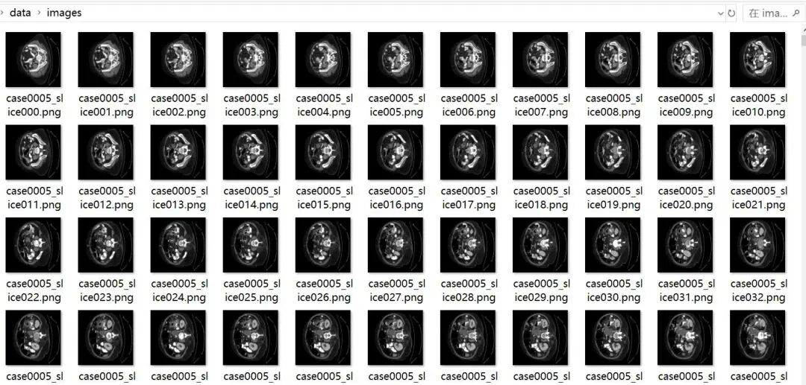
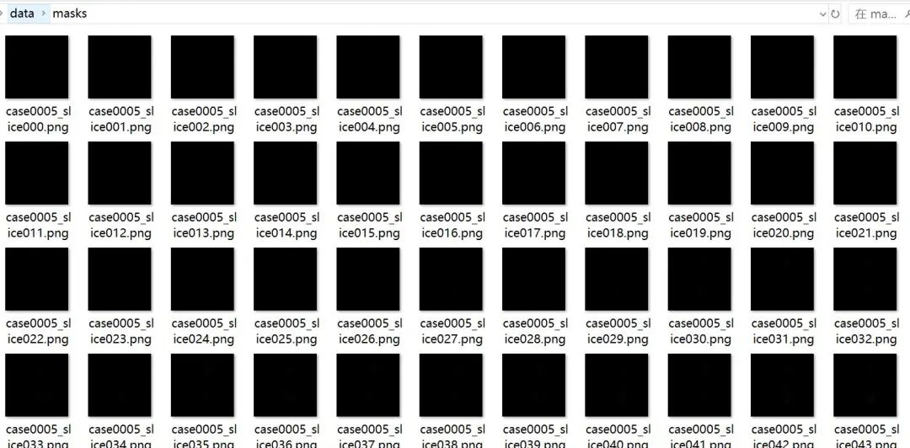
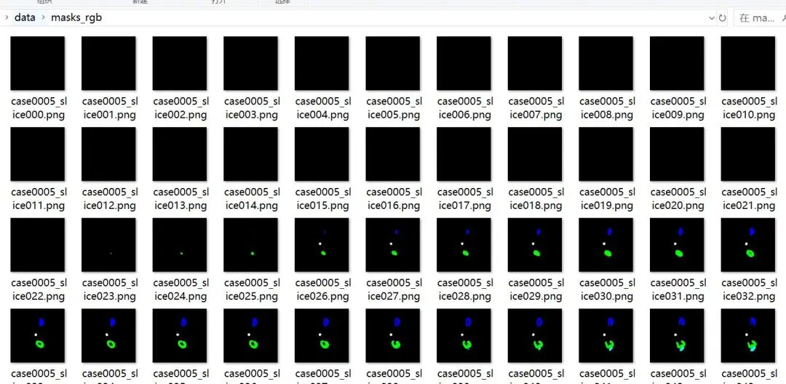

# Synapse Abdomen CT Multi-Organ Segmentation Dataset PNG Images + Mask Images + Color Map Table

## Medical Image Multi-Organ Segmentation Dataset

### Dataset Overview

This dataset is a medical image semantic segmentation dataset, consisting of a total of 2,211 slices images and their corresponding segmentation masks from **18 cases**. It is suitable for training and evaluation of multi-organ/multi-structure automatic segmentation tasks.
Original Image:



Insert image description here.

Mask image:



Insert image description here.

Mask image RGB format:



Insert image description here.

---

### Basic Information

|

Attribute

 ||

Value

 |

|

Total image count

 ||

2,211

 |
|

Number of cases

 ||

18

 |
|

Image resolution

 ||

512 × 512 pixels

 |
|

Image format

 ||

PNG

 |
|

Image type

 ||

Grayscale image (8-bit, single channel)

 |
|

Segmentation category count

 ||

8 Classes (including background)

 |
|

Training set

 ||

1,658 (75%)

 |
|

Test set

 ||

553 yuan (25%)

 |

---

### Directory Structure

```
data/
├── images/  # Original grayscale images (2,211)
├── masks/ # Label mask - Index format (2,211 images, single channel, pixel values 0-7)
├── masks_rgb/  # Label mask - RGB visualization format (2,211 images, three-channel color images)
├── color_map.txt  # Class-color mapping table
├── train.txt  # Training set file list
├── test.txt  # Test set file list

```

---

### File naming conventions

The file naming format is: `case{case number}_slice{slice number}.png`

-

• **Case number**: 4-digit number (e.g., `0005`, `0040`)

-

• **Slice Number**: 3-digit number (e.g., `000`, `142`)

Example: `case0006_slice109.png` represents the 109th slice of case number 6.

---

### Case distribution

|

Case

 ||

Slice count

 ||

Case

 ||

Slice count

 |

|

case0005

 ||

117

 ||

case0026

 ||

131

 |
|

case0006

 ||

131

 ||

case0027

 ||

88

 |
|

case0007

 ||

163

 ||

case0028

 ||

89

 |
|

case0009

 ||

149

 ||

case0030

 ||

153

 |
|

case0010

 ||

148

 ||

case0031

 ||

93

 |
|

case0021

 ||

143

 ||

case0033

 ||

104

 |
|

case0023

 ||

96

 ||

case0034

 ||

98

 |
|

case0024

 ||

124

 ||

case0037

 ||

99

 |
|

—

 ||

—

 ||

case0039

 ||

90

 |
|

—

 ||

—

 ||

case0040

 ||

195

 |

---

### Segmentation tags and color mapping

The dataset contains 8 segmentation categories, with the label definition and color mapping as follows:

|

Tag value

 ||

Color

 ||

RGB values

 ||

Notes

 |

|

0

 ||

⬛ Black

 ||

(0, 0, 0)

 ||

Background

 |
|

1

 ||

⬜ white

 ||

(255, 255, 255)

 ||

Category 1

 |
|

2

 ||

🟥 Red

 ||

(0, 0, 255)

 ||

Category 2

 |
|

3

 ||

🟩 Green

 ||

(0, 255, 0)

 ||

Category 3

 |
|

4

 ||

Blue

 ||

(255, 0, 0)

 ||

Category 4

 |
|

5

 ||

🟨 Yellow

 ||

(0, 255, 255)

 ||

Category 5

 |
|

6

 ||

🟪 Purple

 ||

(255, 0, 255)

 ||

Category 6

 |
|

7

 ||

🩵 Blue

 ||

(255, 255, 0)

 ||

Category 7

 |

>

**Note**: The RGB values in `color_map.txt` are in OpenCV's BGR format.

---

### Mask File Format

The dataset provides two mask formats:

#### `masks/` — Index format

-

• **Format**: Single-channel grayscale image (Mode: `L`)

-

• **Pixel Value**: 0–7, corresponding to the label values in the table above

-

• **Usage**: Directly used for model training, can be used as input for standard segmentation losses such as cross-entropy loss.

#### `masks_rgb/` — RGB visualization format

-

• **Format**: Three-channel color image (Mode: `RGB`)

-

• **Pixel Value**: Colored according to the color map.

-

• **Usage**: Visualization display, result comparison, paper illustrations

---

### Dataset Splitting

The dataset has been pre-divided into training set and test set:

-

• **train.txt**: 1,658 filenames, each on a separate line for model training

-

• **test.txt**: 553 filenames, each on a separate line for model evaluation

The file names in the file list are the names of files in the `images/` directory, and the corresponding mask files have the same filenames in the `masks/` and `masks_rgb/` directories.

---

### Category distribution (asymmetric)

The pixel proportion of each label in the mask is significantly unbalanced:

|

Tags

 ||

Approximate pixel ratio

 |

|

0 (Background)

 ||

~92%

 |
|

5

 ||

~1.8%

 |
|

4

 ||

~0.25%

 |
|

3

 ||

~0.19%

 |
|

7

 ||

~0.29%

 |
|

1

 ||

~0.15%

 |
|

6

 ||

~0.10%

 |
|

2

 ||

~0.06%

 |

>

It is recommended to use a **weighted loss function** (such as Weighted Cross-Entropy, Dice Loss, or Focal Loss) during training to alleviate the problem of class imbalance.

---

### Usage Example

#### PyTorchDataset Example

```
import os
import torch
import numpy as np
from PIL import Image
from torch.utils.data import Dataset
class SegmentationDataset(Dataset):
    def __init__(self, root_dir, split='train', transform=None):
        self.root_dir = root_dir
        self.transform = transform
        self.split = split
# Read file list
        list_file = os.path.join(root_dir, f'{split}.txt')
        with open(list_file, 'r') as f:
            self.filenames = [line.strip() for line in f if line.strip()]
    def __len__(self):
        return len(self.filenames)
    def __getitem__(self, idx):
        fname = self.filenames[idx]
# Reading images and masks
        image = Image.open(os.path.join(self.root_dir, 'images', fname))
        mask = Image.open(os.path.join(self.root_dir, 'masks', fname))
        image = np.array(image)
mask = np.array(mask) # pixel values 0-7
        if self.transform:
            image, mask = self.transform(image, mask)
        else:
            image = torch.from_numpy(image).unsqueeze(0).float() / 255.0
            mask = torch.from_numpy(mask).long()
        return image, mask
# Usage
dataset = SegmentationDataset('path/to/data', split='train')
```

#### Visualization Mask Examples

```
import matplotlib.pyplot as plt
from PIL import Image
# Read raw images and RGB masks
image = Image.open('images/case0006_slice109.png')
mask_rgb = Image.open('masks_rgb/case0006_slice109.png')
fig, axes = plt.subplots(1, 2, figsize=(10, 5))
axes[0].imshow(image, cmap='gray')
axes[0].set_title('Original Image')
axes[0].axis('off')
axes[1].imshow(mask_rgb)
axes[1].set_title('Segmentation mask (RGB)')
axes[1].axis('off')
plt.tight_layout()
plt.show()
```

---

### Notes

1.

1. **Pixel Value Range**: The original image is an 8-bit grayscale image with a pixel value range of [0, 255]. It is recommended to normalize it to [0, 1] before inputting into the model.

1.

2. **Unbalanced Categories**: The background pixels account for about 92% of the total, while the foreground categories are very small. Please use an appropriate loss function or data augmentation strategy.

1.

3. **Data Splitting**: The training set and test set have been fixedly divided, please do not mix them to ensure the fairness of the experiment.

1.

4. **Mask Usage**: Please use the index format masks in the `masks/` directory during training, and `masks_rgb/` is only for visualization purposes.


## Payment

Here is a pay link on Stripe ( https://buy.stripe.com/3cs8yP7sY87d0vu9AB ). Please contact me lonlonago@foxmail.com after funding $89, and I will send you a complete data files , thank you!


